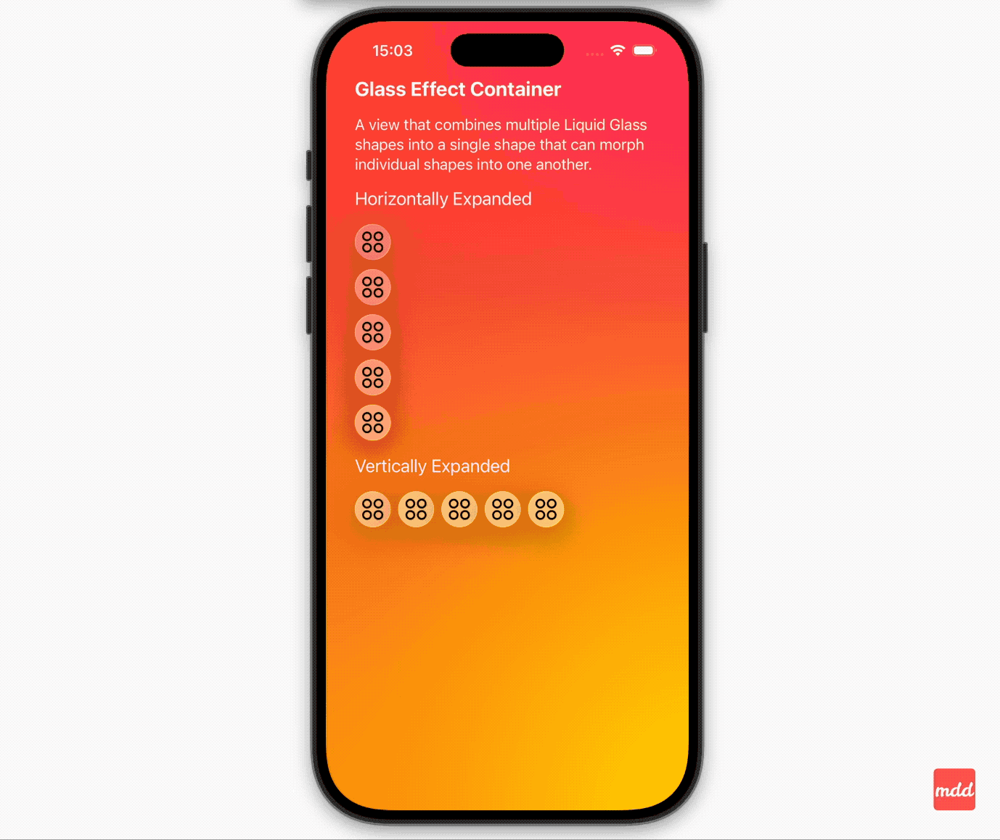

At this year's WWDC, Apple introduced a major visual update the "Liquid Glass" design - a dynamic new material arriving with iOS 26. Yes, you read that right: all the rumours were true, and we're jumping straight from iOS 18 to iOS 26.

How do I feel about the new design?
Honestly, I like it. I did a small side by side comparison using Simulator between iOS 18 and iOS 26. The new look speaks to me more. It feels more modern...

At this point, the design has won me over... but that might just be the novelty effect. I've seen some concerns online about lack of readability in the new interface. I admit that I haven't had a chance yet to try it on a real device (I'm not brave enough to install the very first beta version on my personal iPhone 😅), but I'm really looking forward exploring it more!

Although I haven't updated to the new system yet, I did get my hands on the latest Xcode (luckily it works with macOS 15.4) and some of the new beta APIs. I was especially curious to try something with Liquid Glass design and ended up experimenting with the new `GlassEffectContainer`.

I built a small demo with an expandable / collapsible menu containing four items plus an action button.
- The button changes its icon when tapped and reveals menu items.
- All items are wrapped in `GlassEffectContainer`.
- Each item uses the new `glassEffect` modifier.
- In some menu variations, items are grouped into sets of 2, 3 or 4. using the `glassEffectUnion` modifier, which creates a single, unified glass effect across multiple views.
- Each version of menu experiments with different `GlassEffectContainer` spacing, `HStack`/`VStack` spacing values.

Showtime! 📹


